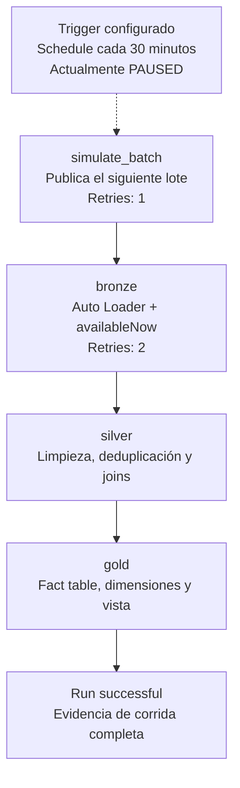
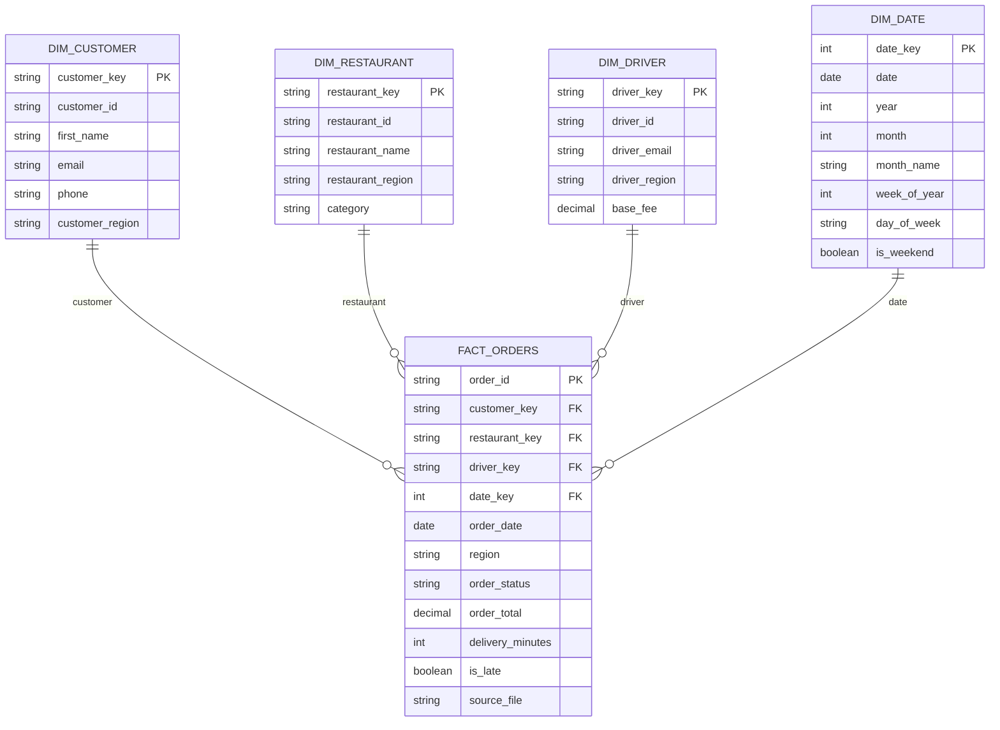

# Delivery360 Databricks

Delivery360 simula la plataforma de una empresa de delivery y construye un flujo completo desde archivos de pedidos hasta un modelo analítico Gold, incorporando ingesta incremental, streaming por micro-lotes, modelo estrella y seguridad a nivel de fila y columna.

## Problema que resuelve

El negocio necesita responder preguntas como:

- ¿Qué regiones y restaurantes tienen más entregas tardías?
- ¿Cuántos pedidos se procesan y cuál es su valor total?
- ¿Qué clientes, restaurantes y conductores están asociados con cada pedido?
- ¿Cómo puede un perfil operativo consultar sus regiones sin ver información personal de clientes?

El proyecto separa los datos crudos, los datos limpiados y los datos analíticos para que el flujo sea repetible, auditable y fácil de explicar.

## Origen de los datos

Los datos son **sintéticos y reproducibles**; no contienen información personal real. El notebook `00_generate_reference_data` los genera con Spark y los escribe como JSON en un Unity Catalog Volume.

El conjunto incluye aproximadamente:

- 2.000 clientes.
- 100 restaurantes.
- 300 conductores.
- 3 lotes de 500 pedidos cada uno.
- Pagos y eventos de pedido asociados (no usados para este desarrollo).

La generación introduce algunos valores inválidos de forma intencional; por ejemplo, estados desconocidos, importes negativos y clientes nulos, para demostrar la limpieza en Silver. Los archivos de `payments` y `order_events` se ingieren en Bronze para conservar la fuente completa; el modelo Gold actual se concentra en `orders` y las tablas de referencia.

Las carpetas de datos son:

```text
/Volumes/delivery360/bronze/raw_files/seed/
/Volumes/delivery360/bronze/raw_files/incoming/
```

`seed` contiene los datos de referencia y los lotes originales. `incoming` representa los archivos que llegan progresivamente a la plataforma.

## Arquitectura

```mermaid
flowchart LR
    A[00_generate_reference_data\nDatos sintéticos] --> B[Volume: seed]
    B --> C[01_simulate_batch\nPublica un lote]
    C --> D[Volume: incoming]
    D --> E[02_bronze\nAuto Loader + availableNow]
    E --> F[(delivery360.bronze)]
    F --> G[03_silver\nTipos, reglas, deduplicación y joins]
    G --> H[(delivery360.silver)]
    H --> I[04_gold\nModelo estrella y métricas]
    I --> J[(delivery360.gold)]
    J --> K[05_governance\nRow filter, column mask y tags]
    K --> L[(delivery360.governance)]
```



El Job de datos ejecuta únicamente:

```text
01_simulate_batch -> 02_bronze -> 03_silver -> 04_gold
```

### Flujo detallado del Lakeflow Job

El Job se compone de cuatro tareas. `simulate_batch` publica un solo lote por ejecución; las tareas siguientes se ejecutan únicamente cuando termina correctamente su dependencia. Bronze tiene dos reintentos configurados y `simulate_batch` tiene uno.



La tarea de gobernanza no forma parte de este DAG. `05_governance` se ejecuta manualmente después de Gold para demostrar el acceso completo, el row filter, las column masks y el rollback sin alterar la corrida principal de datos.

La gobernanza se ejecuta manualmente después de Gold, porque aplica filtros y máscaras sobre tablas que ya deben existir.

El catálogo y sus esquemas son:

```text
delivery360.bronze
delivery360.silver
delivery360.gold
delivery360.governance
```

### Bronze

Auto Loader lee los JSON nuevos desde `incoming` y conserva el archivo de origen en `source_file` y `source_file_name`. Cada entidad tiene su tabla Bronze: `orders`, `payments`, `order_events`, `customers`, `restaurants` y `drivers`.

La ingesta usa `schemaLocation` y checkpoints en el Volume:

```text
/Volumes/delivery360/bronze/checkpoints/
```

El trigger `availableNow` procesa los archivos disponibles y termina. Cada ejecución posterior procesa solamente archivos nuevos gracias al checkpoint.

### Silver

Silver aplica tipos correctos y reglas de calidad explicables:

- Normaliza `order_status` con `trim` y `upper`.
- Reemplaza un `order_total` nulo por cero y descarta importes negativos.
- Conserva únicamente estados válidos: `DELIVERED` y `CANCELLED`.
- Descarta pedidos sin `customer_id`.
- Deduplica por `order_id`, conservando el registro más reciente.
- Hace joins con clientes, restaurantes y conductores.
- Deriva `order_date`, `is_late` y una columna común `region`.

El notebook imprime métricas antes y después de la limpieza para hacer visible el efecto de las reglas.

### Gold

Gold implementa un modelo estrella:

- `fact_orders`: grano de una fila por pedido limpio.
- `dim_customer`.
- `dim_restaurant`.
- `dim_driver`.
- `dim_date`.
- `late_delivery_summary`: vista para analizar entregas tardías por región y restaurante.

### Modelo estrella detallado

El grano de `fact_orders` es **una fila por pedido limpio**. Las claves de negocio conectan la tabla de hechos con sus dimensiones:



Desde este modelo se puede consultar el valor y la puntualidad de los pedidos por cliente, restaurante, conductor, región o fecha. `late_delivery_summary` es una vista agregada sobre `fact_orders` para responder rápidamente qué restaurantes concentran más pedidos tardíos y qué valor bruto representan.

Las dimensiones utilizan las claves de negocio (`customer_id`, `restaurant_id` y `driver_id`) como claves explicables. `dim_date` usa `date_key` en formato `yyyyMMdd` y agrega atributos de calendario.

El diseño está preparado para declarar restricciones informativas `PRIMARY KEY` y `FOREIGN KEY` antes de la demostración final, recordando que Unity Catalog las trata como restricciones informativas.

## Componentes y temas elegidos

La columna vertebral es obligatoria y no se reemplaza:

| Requisito | Implementación |
|---|---|
| V1 Bronze | Auto Loader incremental, `schemaLocation`, checkpoint y archivo de origen por fila. |
| V2 Silver | Tipos, tratamiento de nulos, deduplicación, joins y métricas antes/después. |

Componentes del examen y opcionales elegidos:

| Elemento | Estado | Evidencia principal |
|---|---|---|
| C1 Gold y calidad | Reemplazado por O6 | Modelo estrella y consulta analítica sobre hechos y dimensiones. |
| C2 Orquestación | Elegido | Lakeflow Job con cuatro tareas, dependencias, reintentos y horario configurado. |
| C3 Gobernanza | Reemplazado por O1 | Row filter, column mask, tabla de mapeo, tags y matriz de acceso. |
| C4 CI/CD | Elegido | Git folder, rama de trabajo, pull request integrado a `main` y bundle con targets `dev`/`prod`. |
| C5 Observabilidad y optimización | Reemplazado por O5 | Ingesta por tandas con Auto Loader Structured Streaming y `availableNow`. |
| O1 Seguridad de datos | Elegido; reemplaza C3 | Seguridad por región y protección de PII. |
| O5 Datos en streaming | Elegido; reemplaza C5 | Simulación de archivos que llegan en lotes. |
| O6 Modelo estrella | Elegido; reemplaza C1 | Tabla de hechos, dimensiones, grano y consulta analítica. |

No se eligieron O2, O3, O4, O7, O8, O9 ni O10.

## Decisiones de diseño

1. **Datos sintéticos deterministas.** Permiten repetir la demo sin depender de una API externa.
2. **Separación entre `seed` e `incoming`.** `seed` representa la fuente preparada; `01_simulate_batch` controla qué lote llega y cuándo, haciendo visible el comportamiento incremental.
3. **Un esquema por capa.** `bronze`, `silver`, `gold` y `governance` hacen explícita la propiedad y el nivel de transformación de cada objeto.
4. **Bronze conserva el contrato de entrada.** Se usan esquemas explícitos, metadatos del archivo y checkpoints para demostrar una ingesta confiable sin mezclar reglas de negocio con la captura.
5. **Silver es la frontera de calidad.** Las reglas de tipos, nulos, estados y duplicados se aplican antes de construir el modelo analítico.
6. **`availableNow` en serverless.** Simula micro-lotes de streaming y es compatible con el entorno serverless usado por el proyecto.
7. **Gobernanza fuera del Job principal.** Se ejecuta después de Gold para poder mostrar el efecto del row filter, column mask y rollback de forma controlada.
8. **Horario pausado durante el desarrollo.** El Job tiene un horario de 30 minutos, pero permanece pausado hasta que la demo esté lista para evitar ejecuciones inesperadas.

## Cómo se corre

### Prerrequisitos

El workspace debe tener el catálogo `delivery360` y permisos para crear tablas, schemas y volúmenes. Si el volumen de checkpoints no existe, créalo una vez:

```sql
CREATE VOLUME IF NOT EXISTS delivery360.bronze.checkpoints;
```

Configura el perfil de Databricks CLI usado por el bundle, por ejemplo `delivery360`.

### Flujo inicial

1. Ejecuta una vez `src/notebooks/00_generate_reference_data.py`. Crea los datos sintéticos, los schemas, el Volume de archivos y reinicia el control de lotes.
2. Valida y despliega el bundle:

```powershell
databricks bundle validate -t dev --profile delivery360
databricks bundle deploy -t dev --profile delivery360
```

3. Ejecuta el Job dos o tres veces para publicar y procesar varios lotes:

```powershell
databricks bundle run delivery360_pipeline -t dev --profile delivery360
```

Cada ejecución de `01_simulate_batch` publica un solo lote. Bronze procesa los archivos nuevos; Silver y Gold se reconstruyen con los datos disponibles.

4. Ejecuta manualmente `src/notebooks/05_governance.py` después de Gold. Este notebook crea las tablas de mapeo, aplica el row filter, las column masks y los tags.
5. Ejecuta opcionalmente `src/notebooks/06_governance_demo.ipynb` celda por celda para mostrar acceso completo, acceso restringido, protección de PII y rollback.

El horario del Job está configurado en `resources/delivery_job.job.yml`, pero queda pausado durante el desarrollo. Para una ejecución manual desde la interfaz también se puede usar la opción **Run now** del Job desplegado.

### Evidencias para la presentación

- JSON visibles en el Volume y dos o más lotes en `incoming`.
- Conteo por `source_file` en Bronze para demostrar que cada archivo se procesa una sola vez.
- Métricas antes/después y consultas sobre Silver para mostrar limpieza y deduplicación.
- `fact_orders`, dimensiones, grano documentado y consulta analítica Gold.
- DAG del Lakeflow Job, dependencias, reintentos y corrida exitosa.
- `SHOW GRANTS`, row filter, column mask, tags y matriz de perfiles.
- Repositorio público, rama de trabajo, pull request integrado y `databricks.yml`.

## Estructura del repositorio

```text
databricks.yml
resources/
  delivery_job.job.yml
src/notebooks/
  00_generate_reference_data.py
  01_simulate_batch.py
  02_bronze.py
  03_silver.py
  04_gold.py
  05_governance.py
  06_governance_demo.ipynb
```
